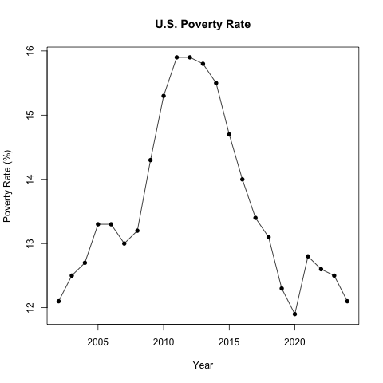
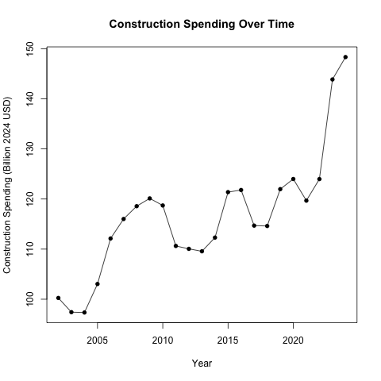
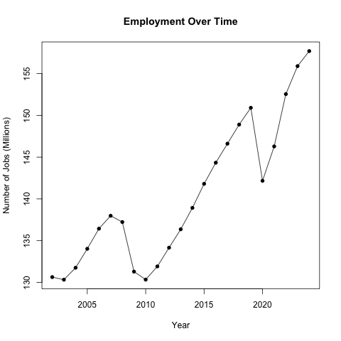
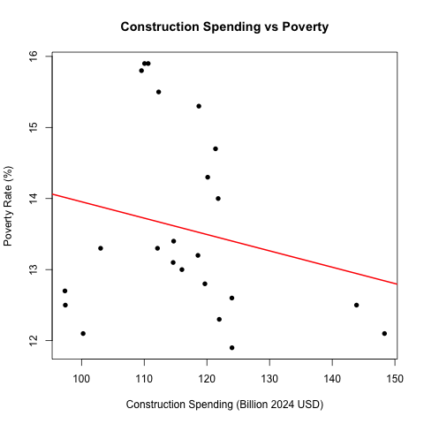
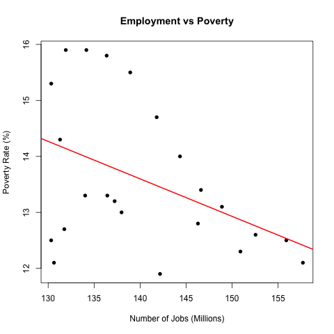

``` {r, include=FALSE}
#Loads all the stuff
source("00_requirements.R")
source("02_Functions.R")

data <- read.csv("data/processed/us_annual_2002_2024.csv")
# Need to do this for my functions later
poverty      <- data$poverty_pct
construction <- data$construction_real_2024_musd/1000
jobs         <- data$jobs_millions

```

# Abstract
This project asks whether highway and street construction spending and the number of jobs predict the poverty rate in the US. We created a dataset for 2002-2024 using public data. We gathered highway and street construction spending, total nonfarm payroll jobs, and the Census Bureau's poverty rate estimate. Povertyrose from 12.1 in 2002 to a peak of 15.9% after the 2008 recession in 2011-2012. Then fell to 11.9% in 2020.
Years with more jobs tend to have lower poverty with a correlation of -0.45, jobs alone explain about 19% of the variation in poverty. Construction spending has a weaker correlation with -0.21. That relationship depends only on 2023 and 2024. The two predictors are highly correlated with eachother .79.

# Introduction

The poverty rate is one of the most widely used metrics for economic well-being. We also understand governments spend large amounts on infrastructure, and spending is defended with creating jobs and supporting economies. Does infrastructure construction however and the number of jobs predict poverty rates in the United States?

# Executive Summary
**Jobs matter more than construction** Jobs Correlation -0.43, COnstruction -0.23
**Poverty Follows Economy** It peaks at 15.9% in 2011-2012 after the great recession and its low in 2020 of 11.9%.

**The predictors overlap.** COnstruction and Jobs are correlatied at .79


# Data
All of our Data comes from Federal Reserve Economic Data, a database ran by the Federal Reserve Bank of St. Louis. The other statistics are provided by the U.S. Census Bureau and the Bureau of Labor Statistics. 

We downloaded four serieses as CSV files and our original files are in "data/raw/":

**TLHWCON**: Total highway and street construction spending (Census Bureau). Monthly, in millions of dollars
**PAYEMS**: Total nonfarm payroll employment (Bureau of Labor Statistics). Monthly, in thousands of people
**PPAAUS00000A156NCEN**: Poverty rate for all ages, from the Small Area Income and Poverty Estimates (Census Bureau). Annual, in percent of people
**CPIAUCSL**: Consumer Price Index for All Urban Consumers. (Bureau of Labor Statistics). Monthly, as an index

**Cleaning and Processing** All of our steps are seen in "11_DataCleaning_Processing.Rmd", using functions from "02_Functions.R"

1. Each file was read, and checked for errors and duplicates, missing values were counted.
Poverty Series was missing: 1990, 1991, 1992, and 1994.
CPI series is missing October 2025.
Missing values were removed.

2. A year was kept only if all 12 months were present. Construction spending was summed up to get a yearly spending. Monthly jobs and CPI values were averaged for all 12 months. This is to keep it matching to our poverty rate

3. We adjusted Construction spending into 2024 dollars using the CPI for each year.

4. We matched each by year, and if one of the series was missing a year, we removed it. The dataseries thus starts in 2002 and ends in 2024.

5. A final recheck is done for duplicate years and missing or negative values and saved to "us_annual_2002_2024.csv"


Our final dataset has 23 observations, and the variables:
'year', 'construction_nominal_musd', 'construction_real_2024_musd', 'jobs_thousands', 'jobs_millions', 'cpi_index', and 'poverty_pct'. 
Our analysis checks 'poverty_pct', 'construction_real_2024_musd', and 'jobs_millions'

** Summary Statistics**

```{r include=FALSE}

# Keeps only 3 variables we care about

vars <- data[, c("poverty_pct", "construction_real_2024_musd", "jobs_millions")]


# Millions to billions

vars$construction_real_2024_musd <- vars$construction_real_2024_musd/1000

#function to give us basic summary stats
describe <- function(x) {
  c(N = length(x), Mean = mean(x), SD = sd(x), Min = min(x), Max = max(x))
}

# apply to each column
desc <- apply(vars, MARGIN = 2, FUN = describe)

# Give columns names and round
colnames(desc) <- c("Poverty rate (%)", "Construction (billion 2024 USD)", "Jobs (millions)")
round(desc, 2)

```
# Visualization

**Poverty over time.** Figure 1 shows that poverty did not move in one direction. It rose, then exploded after the 2008 Recession, to a peak of 15.9& in 2011 and 2012. Then declined to 11.9% in 2020.

```{r fig-poverty, out.width="65%", fig.align="center"}

```

**Construction spending and jobs overtime.** Figure 2 shows that both predictors grew in different patterns. Jobs fell in the 2008 Recession, and again in 2020 during Covid-19, recovering after each drop. Real construction spending rose until the 2008 Recession, dipped in the 2010s, and then jumped sharply in 2023 and 2024. Comparing figure 1 and figure 2 shows two useful patterns. Poverty kept rising until 2011, even though jobs bottomed out at 2010, which suggests poverty responds to the job market but with a 1-2 year delay. Poverty reached its lowest value in 2020, the same year jobs dropped. Which suggest outside factors affect poverty, which we assume is Covid-19

```{r fig-construction-trend, out.width="65%", fig.align="center"}

```
```{r fig-jobs-trend, out.width="65%", fig.align="center"}

```


**Relationships with poverty** Figure 3 plots poverty against each predictor with a fitted regression line. Both of the lines slope down, but the points are scattered. The jobs scatterplot shows a clearer downward pattern however. The construction scatterplot, shows the two years with the highest spending, 2023 and 2024, sit far to the right of the other points and both have low poverty, so their influence on the line is large.

```{r fig-construction-poverty, out.width="65%", fig.align="center"}

```
```{r fig-jobs-poverty, out.width="65%", fig.align="center"}

```

**Correlations**:

```{r, echo=FALSE}
## Correlation matrix of the three variables 
cor_matrix <- cor(vars)

print(cor_matrix, 3)
```

This correlation matrix confirms what the scatter plots are showing. Poverty has a weak negative correlation with construction of -0.214 and a moderate negative correlation with jobs -0.434, the two predicators are strongly correlated with eachother 0.791. This is important for the regression, since it is hard to tell which one is responsible for the changes in poverty.

**Simple linear Regression**

For one predictor x, and the response y, the regression line can be found with the formulas: b=r* sy/ sx, a = ybar- bxbar, R^2 = r^2

Where r is the correlation, sx and sy are the standard devations, and xbar and ybar are the means.

We made a function "simple_regression" to find this,
```{r, echo=FALSE}
#input x, y response output, a list that shows the regression line and Rsquared
simple_regression <- function(x, y) {
  r         <- cor(x, y)
  slope     <- r * sd(y) / sd(x)
  intercept <- mean(y) - slope * mean(x)
  r_squared <- r^2

  result <- list(intercept = intercept, slope = slope, r_squared = r_squared)
  return(result)
}
#Use function
fit_construction <- simple_regression(x = construction, y = poverty)
fit_jobs         <- simple_regression(x = jobs,         y = poverty)

#put in table

predictor  <- c("Construction (billions)", "Jobs (millions)")
intercepts <- c(fit_construction$intercept, fit_jobs$intercept)
slopes     <- c(fit_construction$slope,     fit_jobs$slope)
r_squareds <- c(fit_construction$r_squared, fit_jobs$r_squared)
#table
simple_table <- data.frame(predictor, intercepts, slopes, r_squareds)

print(simple_table)

```


# Analysis


**Preliminary Model** We fit a multiple linear regression of the poverty rate on real construction spending and jobs.